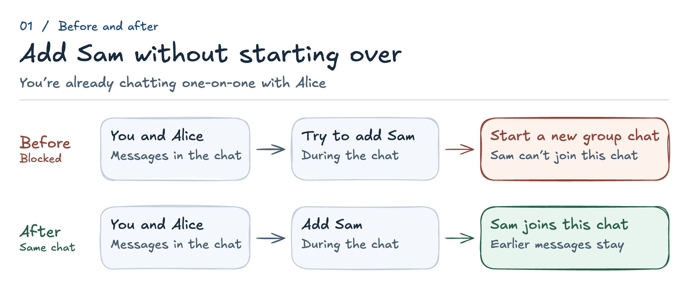
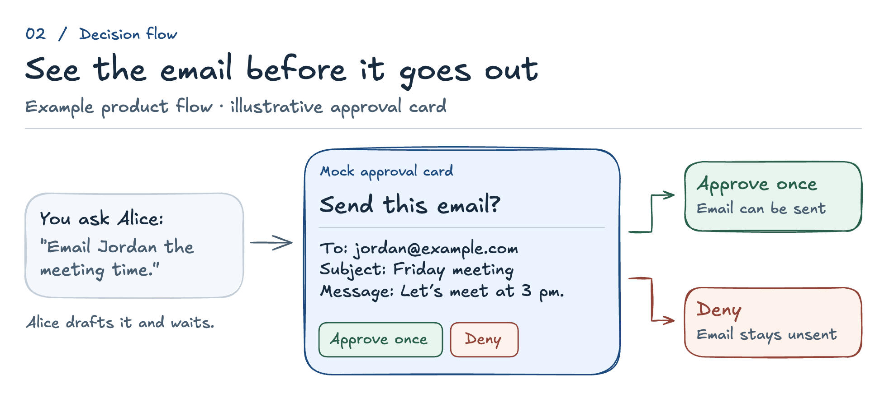
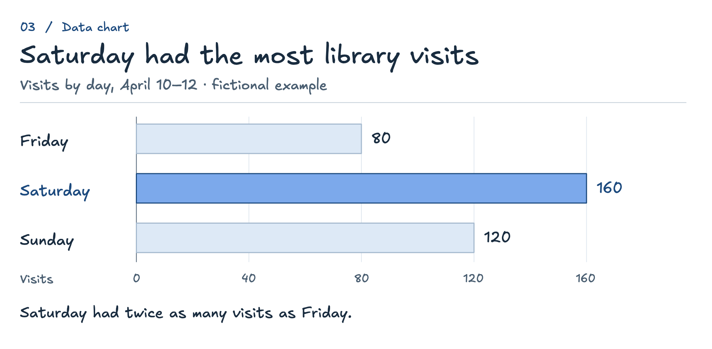

# Excalidraw Explainers

An agent skill for making editable Excalidraw diagrams that make sense without someone there to explain them. Include every detail a first-time reader needs, and leave out anything that doesn't change the answer.

## Examples

### Before and after: Add someone during a chat

Both paths start with a chat already in progress. The diagram shows exactly what breaks before the change and what happens to the earlier messages after it.

[Editable Excalidraw file](https://raw.githubusercontent.com/amrtawfik160/excalidraw-explainers/main/examples/mid-chat.excalidraw)

### Decision flow: Approve an email before it goes out

Instead of saying “review the action,” the mockup shows the recipient, subject, and message, plus what happens if you approve or deny.

[Editable Excalidraw file](https://raw.githubusercontent.com/amrtawfik160/excalidraw-explainers/main/examples/email-approval.excalidraw)

### Data chart: Which day had the most library visits?

A zero-based bar chart gives the timeframe, units, and exact counts. It highlights Saturday and labels the data as fictional.

[Editable Excalidraw file](https://raw.githubusercontent.com/amrtawfik160/excalidraw-explainers/main/examples/library-visits.excalidraw)

To edit a sample, save its `.excalidraw` file and open it in [Excalidraw](https://excalidraw.com/). All three examples use editable text and shapes.

## Use the skill

**Claude Code:** Copy [`SKILL.md`](SKILL.md) to `~/.claude/skills/excalidraw-explainers/SKILL.md` for your account, or to `.claude/skills/excalidraw-explainers/SKILL.md` in a project.

**Aside or another agent:** Add `SKILL.md` to your agent's skill library, or share the file with the agent and ask it to follow it.

Example prompt:

> Use `excalidraw-explainers` to show a first-time reader how our returns process works. Start with an example order, show what changes if the item is outside the return window, and give me an editable Excalidraw file.

The skill does not install an Excalidraw integration. With one connected, the agent can edit a live board. Without one, ask for an editable `.excalidraw` file you can open yourself.
